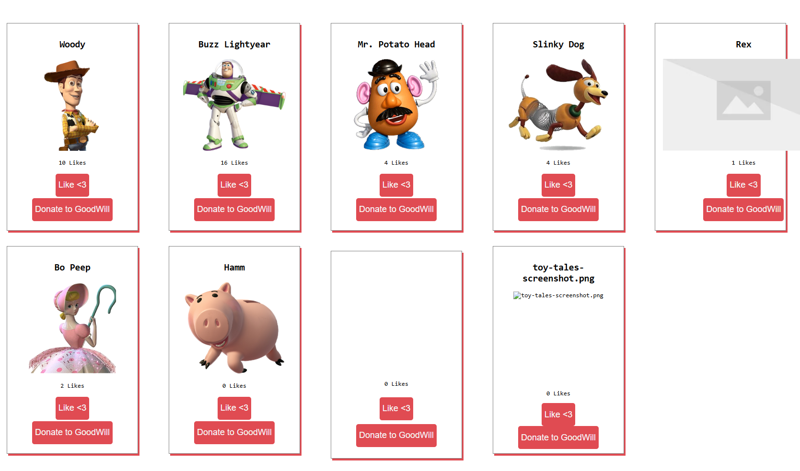

# Toy Tales – React CRUD Application

## Project Description

Toy Tales is a React application that helps Andy manage his collection of toys. Users can view toys, add new toys, increase their likes, and donate toys by removing them from the collection.

The application uses React for the user interface and JSON Server as a simple REST API backend.

## Technologies Used

- React
- JavaScript
- HTML and CSS
- Vite
- JSON Server
- Vitest
- React Testing Library

## Getting Started

### 1. Clone the repository

```bash
git clone https://github.com/Wycliffe1738/react-hooks-toy-tales-vite.git
cd react-hooks-toy-tales-vite
```

### 2. Install dependencies

```bash
npm install
```

### 3. Start the backend server

```bash
npm run server
```

The JSON Server API runs at:

`http://localhost:3001`

The toys are stored in `db.json`.

### 4. Start the React application

Open another terminal in the project directory and run:

```bash
npm run dev
```

Open the local URL displayed by Vite, normally:

`http://localhost:5173`

## Application Features

### 1. Display Toys (GET)

When the application loads, it sends a GET request to `/toys` to retrieve all toys from the backend.

The toys are stored in the App component's state and displayed using ToyContainer and ToyCard components.

### 2. Add a Toy (POST)

Users can open the toy form and enter a toy's name and image URL.

When the form is submitted, a POST request saves the new toy to the backend. The new toy is then added to the displayed collection with an initial like count of zero.

### 3. Like a Toy (PATCH)

When a user clicks the Like button, a PATCH request updates the selected toy's likes on the backend.

The updated toy is reflected in the application without changing the order of the other toys.

### 4. Donate a Toy (DELETE)

When a user clicks the Donate to GoodWill button, a DELETE request removes the selected toy from the backend.

The toy is also removed from the displayed collection.

## Running the Tests

Run the test suite using:

```bash
npm run test -- --run
```

The application has passed all five provided tests covering toy display, toy creation, liking toys, and deleting toys.

## Production Build

To create a production build, run:

```bash
npm run build
```

## Project Structure

```text
react-hooks-toy-tales-vite/
├── db.json
├── public/
├── src/
│   ├── __tests__/
│   ├── components/
│   │   ├── App.jsx
│   │   ├── Header.jsx
│   │   ├── ToyCard.jsx
│   │   ├── ToyContainer.jsx
│   │   └── ToyForm.jsx
│   ├── index.css
│   └── main.jsx
├── index.html
├── package.json
├── vite.config.js
└── README.md
```

## Application Screenshot


